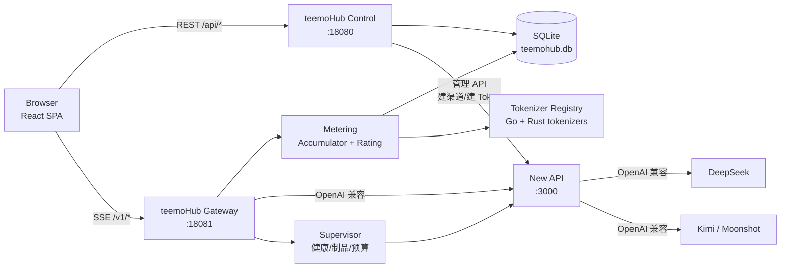
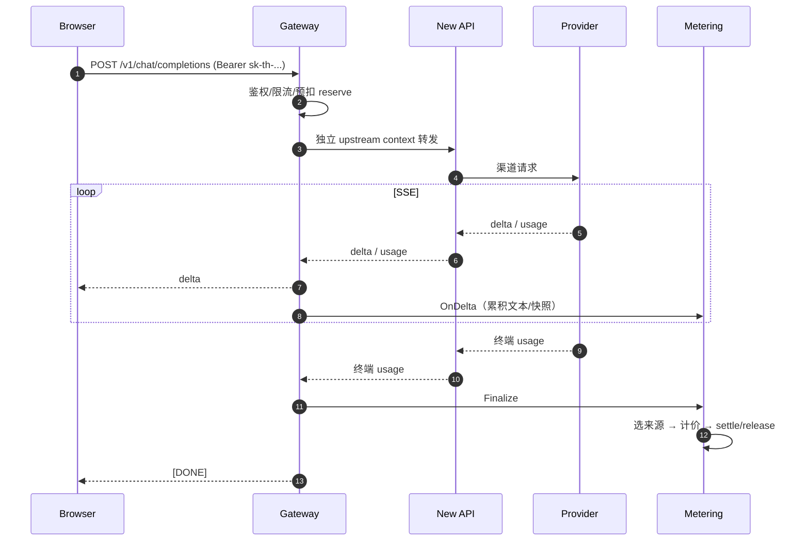
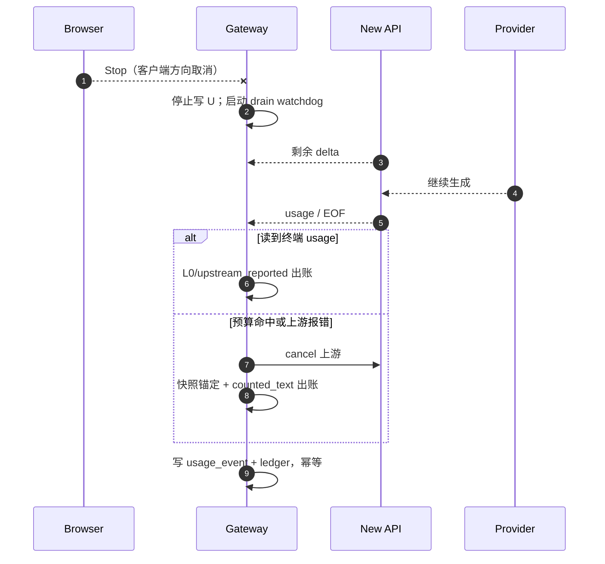

# teemoHub 功能需求文档（FRD）

**版本**：v0.10（2026-11-10）
**定位**：本地可运行的 AI 网关与计量计费系统，对标 Token Rhythm 的产品形态
**上游**：现有 New API（不改源码）+ Kimi / DeepSeek
**关联文档**：`/Users/chuanhe/rea-scan/ai-gateway-rebuild-design.md`（架构与计费设计，以下简称“主设计”）

---

## 0. 摘要（先看这 8 条）

1. **目标**：在本机跑通“登录 → 创建 Key → 网关 → New API → Kimi/DeepSeek → 计量计费 → 前端看账”的完整闭环，并复现主设计里的断流计费逻辑。
2. **边界**：New API 保持不动，只作为上游执行器；teemoHub 自建控制面、数据面、计量与账本；Provider Key 只存在 New API。
3. **语言选型**：控制面、网关、计量全部 **Go**；只有 tokenizer 内核计划用 **Rust**（HF `tokenizers` crate；默认经同节点 UDS sidecar 接入，保持 Go 侧 `CGO_ENABLED=0`，cgo 绑定仅作可选构建）。**当前代码尚未接入 Rust**，仍是 Go 启发式估算（见 5.1、5.5、13.4）。不把数据面改成 Rust。
4. **计费优先级**：`provider_final > provider_partial > counted_text > estimate_text > estimate_prompt_only > none`；Mode A 下必须再标 `usage_trust`，因为 New API 可能自算 usage。
5. **断流**：上游请求使用 detached context；客户端断开只停写客户端，上游按六维 drain 预算继续读；拿不到 usage 时用“最后快照锚定 + 尾部增量 × 校准系数”。
6. **账本**：金额一律 nanoCNY int64；预扣 `reserve` → 结算 `settle` → 释放 `release`；修正只追加 `adjustment`；事件幂等键 `(request_id, attempt, stream_seq)`。
7. **前端**：React + TypeScript + Vite；P0 页面为登录、概览、API Key、Playground（含 Stop 断流）、请求日志、管理台（价格/渠道/用户）。
8. **验收**：DeepSeek/Kimi 流式与非流式、工具调用、reasoning、0.5s/1s/2s/5s 主动断流、账本平衡、事件不重复、前端可见 `usage_source` 与 `end_reason`。

---

## 1. 背景、目标与约束

### 1.1 背景

现有 New API 已运行约半年，承担渠道管理、协议适配与基础用量统计；其缺陷集中在多租户、限流灵活性和流式断开后的计费。teemoHub 的目标不是替换 New API，而是在它前面加一层可控的数据面与控制面，把“计量”和“计费”从 New API 中解耦出来。

### 1.2 目标

| 编号 | 目标 | 可验证结果 |
|---|---|---|
| G1 | 本地端到端可运行 | 一条命令启动 New API + teemoHub；浏览器登录后能完成对话并看到费用 |
| G2 | 精确计量 | 正常结束优先用 provider usage；断流有可解释的兜底与误差上界 |
| G3 | 可审计 | 每个请求有 `usage_source`、`usage_trust`、`end_reason`、token 明细与账本流水 |
| G4 | 安全 | 仅监听 127.0.0.1；Provider Key 不进 teemoHub；不记录正文 |
| G5 | 可演进 | P0 单机 all-in-one；P1 可拆成独立 control / gateway / meter 服务 |
| G6 | 可回归 | 自动化 E2E 覆盖正常、断流、工具、reasoning、并发与幂等 |

### 1.3 非目标（P0 不做）

- 公网部署、备案、支付通道、发票、税务。
- 多地域、多活、跨机 tokenizer。
- 图片/视频/音频/embeddings（Kimi/DeepSeek 当前主用能力不覆盖）。
- 复杂 RBAC、SSO、组织层级；P0 只有 `admin` 与 `user`。
- 修改 New API 源码或数据库结构。

### 1.4 约束

- 本机已有 Go 1.27、Rust 1.99、Node 26、SQLite 3.51；8080/8081 被其他项目占用，teemoHub 使用 18080/18081，New API 使用 3000。
- 所有服务绑定 `127.0.0.1`，不对外网开放。
- Provider Key 只写入 New API 的渠道配置；teemoHub 只持有 New API 的用户 Token。
- 金额计算不得使用浮点；统一 int64 nanoCNY（1e-8 元）。
- 流式请求必须支持客户端主动断开，且不得因此静默丢计费。

---

## 2. 角色与核心场景

| 角色 | 说明 | 主要操作 |
|---|---|---|
| 管理员 admin | 本机所有者 | 初始化、建用户、配渠道、定价、看全局账 |
| 普通用户 user | 使用 API/Playground 的人 | 登录、建 Key、对话、看自己的用量与余额 |
| 上游 New API | 渠道执行器 | 接收 OpenAI 兼容请求，转发 Kimi/DeepSeek |
| 上游 Provider | Kimi / DeepSeek | 生成 token，返回 usage（若支持） |

核心场景：

1. 管理员启动服务，初始化 root 与两个渠道。
2. 用户登录 teemoHub，创建 `sk-th-...` Key。
3. 用户在 Playground 选择模型并流式对话。
4. 用户中途点 Stop；网关继续 drain 到预算边界，产出 usage 事件与账本流水。
5. 用户在“请求日志”看到 token、费用、`usage_source`、`usage_trust`、`end_reason`、drain 结果。
6. 管理员在“对账”页对比 teemoHub 事件与 New API 日志，确认偏差。

---

## 3. 术语

| 术语 | 含义 |
|---|---|
| Mode A | teemoHub Gateway → New API → Provider；P0 采用 |
| Mode B | teemoHub Gateway 直连 Provider；P1 可选 |
| provider_final | 直连 Provider 时，响应内终端 usage |
| upstream_reported | Mode A 下 New API 返回的终端 usage；可能是 provider 真值，也可能是 New API 自算 |
| provider_partial | 流中最后一个完整 usage 快照（累计语义） |
| counted_text | 用本地 tokenizer 对完整语义文本计数 |
| usage_trust | `certified / reported / synthetic_suspected`，标识上游 usage 可信度 |
| 快照锚定 | 断流时以最后 usage 快照为锚，只对之后的本地增量做校准 |
| drain | 客户端断开后，网关在预算内继续读上游直到终端 usage |
| 预扣 / 结算 | `reserve` 冻结额度；`settle` 按实际金额入账 |
| nanoCNY | 1e-8 元，所有金额的整数单位 |

---

## 4. 总体架构

### 4.1 部署视图



P0 采用单二进制 `teemohub`，同时监听 18080（控制面 + 静态前端）与 18081（数据面）；代码按模块隔离，P1 可拆进程。

### 4.2 组件职责

| 组件 | 职责 | 不做什么 |
|---|---|---|
| Control Plane | 登录、用户、Key、价格、渠道元数据、日志查询、管理 API | 不接触流式正文 |
| Gateway | OpenAI 兼容入口、鉴权、转发 New API、SSE、断开检测、drain | 不直连 Provider（P0） |
| Accumulator | 按通道累积语义文本、抓取 usage 快照、终态判定 | 不做定价 |
| Tokenizer Registry | 加载/校验 tokenizer 制品，进程内热模型 + 同节点长尾 | 不跨机、不出节点 |
| Metering / Rating | usage 归一化、快照锚定、校准、nanoCNY 计价 | 不接触 Provider Key |
| Ledger | 预扣/结算/释放/调整、双分录、幂等 | 不做 HTTP |
| Supervisor | New API 健康、tokenizer 版本、drain 并发与预算 | 不代理业务流量 |
| Web | 登录、Key、Playground、日志、管理台 | 不保存 Provider Key |

### 4.3 正常请求时序



### 4.4 断流时序



---

## 5. 技术选型（Go 还是 Rust）

### 5.1 结论

**Go 承担 95% 的代码；Rust 只做 tokenizer 内核。** 不建议把网关或计费服务用 Rust 重写。

| 模块 | 语言 | 理由 |
|---|---|---|
| Control Plane | Go | 与 New API 同栈，DTO/协议复用成本低；CRUD 与并发模型简单 |
| Gateway | Go | SSE 转发、`context.WithoutCancel`、连接池、超时控制成熟；I/O 密集，Rust 无显著收益 |
| Accumulator / Rating / Ledger | Go | 逻辑确定、可测试；int64 计算；与事件管道同进程 |
| Tokenizer 内核 | Rust（待接入） | HuggingFace `tokenizers` 是事实标准；DeepSeek 的自定义 BPE 需要精确实现；Go 原生移植滞后。Kimi 的制品格式需按账号实际发布确认（HF `tokenizer.json` 或 tiktoken BPE） |
| Tokenizer 接入 | Go ↔ Rust | 默认同节点 UDS sidecar，保持 `CGO_ENABLED=0` 与 `modernc.org/sqlite` 的纯 Go 构建；`github.com/daulet/tokenizers`（cgo）仅作 `-tags tokenizers_cgo` 可选构建，不进入默认 `make build` |
| Web | TypeScript + React + Vite | 前端迭代快；SSE 与中断用原生 `fetch`/`AbortController` |
| DB | SQLite（WAL） | 单机零运维；P1 换 PostgreSQL |
| 上游 | New API（Go） | 保持不动，复用渠道/协议/密钥管理 |

> **现状（2026-11-10）**：`internal/meter/tokenizer.go` 仍是启发式计数，控制台 API 返回 `tokenizer=heuristic-calibrated`；Rust 内核尚未接入。5.4/5.5 是接入约定，不代表已完成能力。

### 5.2 为什么不全 Rust

- 网关瓶颈是网络与上游生成速度，不是 CPU；Rust 的重写成本换不来可感知的尾延迟收益。
- New API 是 Go，复用其 OpenAI/Claude/Gemini DTO 与转换逻辑最省事。
- 计费需要快速迭代规则、对账、埋点；Go 的可维护性更好。
- Rust 的价值集中在“精确 tokenizer”这一个窄边界，把它隔离成库/sidecar 即可。

### 5.3 为什么不全 Go

- DeepSeek 使用自定义 BPE；Kimi/Moonshot 的制品格式以账号实际发布为准（HF `tokenizer.json` 或 tiktoken BPE），不能默认两者同构。用错误的 tokenizer 近似会在断流兜底时产生系统性偏差。
- 能拿到官方制品时，`tokenizers` crate（HF `tokenizer.json`）或 `tiktoken-rs`（BPE）可复现 Provider 的 encode 结果，这是校准金标的基础；精确计数生效时必须关闭该请求的 EMA 校准（k=1），否则会双重修正。

### 5.4 Tokenizer 制品策略

| 模型族 | 制品 | 加载方式 |
|---|---|---|
| DeepSeek | 官方 `tokenizer.json`（本地文件，SHA-256 固定） | 启动加载，按 model_family×version 缓存 |
| Kimi / Moonshot | 官方制品（HF `tokenizer.json` 或 tiktoken BPE，按账号实际发布确认；SHA-256 固定） | 按格式选择 `tokenizers` / `tiktoken-rs` 后端 |
| 其他 OpenAI 兼容 | `tiktoken` 编码（cl100k/o200k） | 进程内 |
| 长尾/大词表 | 同节点 Rust sidecar（UDS） | 受限并发，不出节点 |

启动时校验 SHA-256 与制品许可；缺失、哈希不符、格式不支持或 sidecar 不可用时降级为 `estimate_chars`，事件标 `tokenizer_id=estimate` 并记录 `fallback_reason`，禁止把该样本当作校准金标。运行时只读本地制品，不联网下载。

### 5.5 Rust 接入约定与验收（2026-11-10）

当前尚未接入 Rust；落地时按以下约定执行，避免“先上 cgo 再回退”的返工：

1. **交付形态**：默认同节点 UDS sidecar，Go 侧保持 `CGO_ENABLED=0`；cgo 绑定只在显式 `-tags tokenizers_cgo` 下编译，不进入 `make build` 与默认发布物。
2. **进程契约**：UDS 路径、模型族→制品映射、请求/响应 JSON schema 固定并版本化；启动探活、最大并发、单请求超时、最大输入字节数可配置；sidecar 崩溃由进程管理器拉起，拉起期间网关降级 estimate，不阻塞请求。
3. **失败语义**：超时、崩溃、SHA 不匹配、模型无制品 → `usage_source=estimate_text` / `tokenizer_id=estimate`，请求照常返回；所有降级样本排除在校准池外，并在 `/healthz` 的 `checks[]` 暴露 sidecar 与制品状态。
4. **版本固定**：`rust-toolchain.toml` 固定 1.99.x；`tokenizers` / `tiktoken-rs` 使用精确版本与显式 features（regex 后端变化会改变切分结果）；制品记录 SHA-256、来源与许可，升级必须跑金标回归。
5. **金标回归**：每个模型族保留 20–50 条 `provider_final` 样本（中英混排、工具调用、长 prompt），要求本地 encode 计数与 Provider 终态 usage 一致；不一致先查制品版本，再查 chat template 的 envelope 开销。
6. **验收基线**：sidecar 冷启动 < 2s；8k token 计数 p99 < 20ms；故障注入下网关可用性不受影响且降级可对账；精确计数请求的 `calibration_id` 为空（k=1）。数值按本机实测校准后再固化。

---

## 6. 功能需求

优先级：P0 必须；P1 可后续。

### 6.1 账号、会话与租户

| 编号 | 需求 | 优先级 | 验收 |
|---|---|---|---|
| FR-AUTH-001 | 管理员账号由启动配置初始化（用户名 + bcrypt 密码） | P0 | 首次启动可登录 |
| FR-AUTH-002 | 用户名密码登录，签发 httpOnly 会话 Cookie | P0 | 登录后 `/api/me` 返回用户 |
| FR-AUTH-003 | 登出、会话过期、密码修改 | P0 | 过期后 401 |
| FR-AUTH-004 | 管理员可创建/禁用普通用户 | P0 | 禁用后无法登录 |
| FR-AUTH-005 | 每个用户默认一个租户 `tenant_id` | P0 | 数据按租户隔离 |
| FR-AUTH-006 | 登录失败限流与审计 | P0 | 连续失败触发 429 |

### 6.2 API Key

| 编号 | 需求 | 优先级 | 验收 |
|---|---|---|---|
| FR-KEY-001 | 创建 Key，格式 `sk-th-<random>`，仅创建时明文展示一次 | P0 | 列表只显示前缀与末四位 |
| FR-KEY-002 | 存储 SHA-256 哈希，不存明文 | P0 | 数据库无明文 |
| FR-KEY-003 | 吊销、启用/禁用、备注、过期时间 | P0 | 吊销后 401 |
| FR-KEY-004 | Key 级配额：RPM、TPM（60s 滑动窗口）、并发、`max_output` | P1 | 超限 429 + `Retry-After` |
| FR-KEY-005 | Key 绑定租户与默认模型白名单 | P0 | 越权模型 403 |
| FR-KEY-006 | 创建 Key 时从管理侧预置的“使用范围”下拉选择（模型白名单 + 计费倍率），列表展示范围与倍率 | P1 | 范围外模型 403 `model_not_allowed`；停用范围 403 `key_scope_disabled`；倍率仅作用于客户侧费用 |

### 6.3 模型目录与路由

| 编号 | 需求 | 优先级 | 验收 |
|---|---|---|---|
| FR-MOD-001 | 从配置加载模型别名到 New API 模型名的映射 | P0 | `/v1/models` 可见 |
| FR-MOD-002 | 支持 `deepseek-chat`、`deepseek-reasoner`、Kimi 文本模型 | P0 | 至少各一个模型可调用 |
| FR-MOD-003 | 模型级价格、tokenizer_id、能力标记（reasoning/tools/vision） | P0 | 计费与路由使用同一配置 |
| FR-MOD-004 | 上游健康检查与简单故障转移（P0 单渠道可跳过） | P1 | 健康状态可见 |
| FR-MOD-005 | 模型别名（如 `th/deepseek-chat`）与透传名并存 | P1 | 两种都可调用 |

### 6.4 网关协议

| 编号 | 需求 | 优先级 | 验收 |
|---|---|---|---|
| FR-GW-001 | `POST /v1/chat/completions`，流式/非流式 | P0 | 与 OpenAI 兼容 |
| FR-GW-002 | `GET /v1/models` | P0 | 返回 OpenAI 格式 |
| FR-GW-003 | Bearer `sk-th-...` 鉴权，注入 trace_id | P0 | 无 Key 401 |
| FR-GW-004 | 透传 `tools`、`tool_choice`、`response_format`、`reasoning_effort` 等字段 | P0 | 请求体不被裁剪 |
| FR-GW-005 | `POST /v1/responses` 透传（若 New API/上游支持） | P1 | 不支持时返回明确 400 |
| FR-GW-006 | `POST /v1/messages` 透传/转换（若 New API 支持） | P1 | 同上 |
| FR-GW-007 | 请求体 10 MB 上限、并发上限、SSE 空闲超时 | P0 | 超限有明确错误 |
| FR-GW-008 | 上游错误码映射与脱敏 | P0 | 不泄漏 Provider Key |

### 6.5 流式、断开与 drain

| 编号 | 需求 | 优先级 | 验收 |
|---|---|---|---|
| FR-STR-001 | 上游请求使用独立 context（`context.WithoutCancel`），客户端断开不直接取消上游 | P0 | 断流后仍能读到 usage |
| FR-STR-002 | 客户端断开后停止写客户端，继续读上游 | P0 | 无 panic、无泄漏 |
| FR-STR-003 | 六维 drain 预算：时间/输出 token/字节/额外成本/静默/并发 | P0 | 命中任一立即 cancel 上游 |
| FR-STR-004 | 收到终端 usage/EOF 正常关闭；有 `finish_reason` 无 usage 进入 grace window | P0 | 事件 end_reason 正确 |
| FR-STR-005 | 记录 `drain_started/outcome/ms/bytes/cost_nano` | P0 | 日志可查 |
| FR-STR-006 | 每租户可配置 drain 策略（0 = 立即断） | P1 | 配置生效 |

### 6.6 计量与计费

| 编号 | 需求 | 优先级 | 验收 |
|---|---|---|---|
| FR-MET-001 | 按通道累积 content/reasoning/tool name+args | P0 | 工具参数不丢失 |
| FR-MET-002 | 抓取每个 chunk 的 usage，归一化 cumulative/incremental，保留最后完整快照 | P0 | 不重复累加 |
| FR-MET-003 | 终态选择来源：final > partial > counted_text > estimate > none | P0 | `usage_source` 正确 |
| FR-MET-004 | Mode A 标记 `usage_trust`（certified/reported/synthetic_suspected） | P0 | 事件可区分 |
| FR-MET-005 | 断流时快照锚定：`T_snap + clamp(round(k_s × ΔT_local), 0, max)` | P0 | 有单测与实测 |
| FR-MET-006 | 隐藏 reasoning 模型改用整段校准，不做锚定 | P0 | 配置可切换 |
| FR-MET-007 | nanoCNY 计价，单次 half-up 舍入，双价格（客户/成本） | P0 | 金额为整数 |
| FR-MET-008 | 预扣、结算、释放、调整；双分录平衡 | P0 | 任意时点借贷平衡 |
| FR-MET-009 | 事件幂等 `(request_id, attempt, stream_seq)` | P0 | 重放不重复入账 |
| FR-MET-010 | 校准表与金标样本管理 | P1 | 可查看 k_s 与样本数 |
| FR-MET-011 | 对账视图：事件 vs New API 日志 | P0 | 偏差可见 |

### 6.7 账本与余额

| 编号 | 需求 | 优先级 | 验收 |
|---|---|---|---|
| FR-LED-001 | 用户余额（nanoCNY），管理员可充值/调整 | P0 | 余额变动有流水 |
| FR-LED-002 | 请求前预扣，失败/取消释放剩余 | P0 | 不长期占用 |
| FR-LED-003 | 结算后余额与流水一致 | P0 | 对账为零 |
| FR-LED-004 | 余额不足拒绝请求（402/429） | P0 | 不产生负余额 |

### 6.8 日志与追踪

| 编号 | 需求 | 优先级 | 验收 |
|---|---|---|---|
| FR-LOG-001 | 每个请求记录 request_id、trace_id、模型、状态、延迟、TTFT | P0 | 可检索 |
| FR-LOG-002 | 记录 usage 明细、来源、信任级别、end_reason、drain 结果 | P0 | 与事件一致 |
| FR-LOG-003 | 默认不存正文，只存 `text_sha256`、长度、通道计数 | P0 | 数据库无正文 |
| FR-LOG-004 | 管理员可按用户/模型/来源/时间筛选 | P0 | 分页可用 |
| FR-LOG-005 | 结构化 JSON 日志与 `/metrics` | P1 | 可接入监控 |

### 6.9 管理台

| 编号 | 需求 | 优先级 | 验收 |
|---|---|---|---|
| FR-ADM-001 | 用户管理：创建、禁用、重置密码、余额调整 | P0 | 操作留痕 |
| FR-ADM-002 | 渠道视图：New API 渠道状态、模型列表、usage_trust | P0 | 只读/可跳转 |
| FR-ADM-003 | 价格表：模型 × 输入/输出/缓存/推理单价、版本 | P0 | 修改后新请求生效 |
| FR-ADM-004 | 断流策略：默认预算与租户覆盖 | P1 | 可配置 |
| FR-ADM-005 | 对账页：日偏差、异常请求、调整入口 | P1 | 可导出 |

### 6.10 Playground

| 编号 | 需求 | 优先级 | 验收 |
|---|---|---|---|
| FR-PG-001 | 选择模型、输入消息、流式输出 | P0 | 文本逐字出现 |
| FR-PG-002 | Stop 按钮立即中断前端流，触发网关断流路径 | P0 | 日志出现 client_cancel |
| FR-PG-003 | 每次响应展示 token、费用、来源、end_reason | P0 | 与日志一致 |
| FR-PG-004 | 支持 system/user/assistant 多轮 | P0 | 上下文正确 |
| FR-PG-005 | 支持工具调用展示（name/arguments/结果） | P1 | 可读 |

### 6.11 健康与运维

| 编号 | 需求 | 优先级 | 验收 |
|---|---|---|---|
| FR-OPS-001 | `/healthz` 返回自身、DB、New API、tokenizer 状态 | P0 | 200/503 |
| FR-OPS-002 | 启动时迁移数据库、校验配置 | P0 | 失败给出明确原因 |
| FR-OPS-003 | 优雅退出，等待在途请求与 drain 完成 | P0 | 无截断账本 |
| FR-OPS-004 | 一键启动/停止脚本与 PID/日志 | P0 | `make up/down` |

---

## 7. 非功能需求

| 类别 | 要求 |
|---|---|
| 延迟 | 非流式附加 P99 < 10 ms；流式每 chunk < 2 ms；终态 tokenize P99 < 5 ms@8 KB |
| 吞吐 | 单机 ≥ 100 并发流；SQLite WAL；事件写入异步 outbox |
| 可用性 | New API 短时故障不崩网关；请求失败可重试（仅未交付 attempt） |
| 安全 | 仅 127.0.0.1；密钥文件 0600；日志脱敏；密码 bcrypt；Key SHA-256；CSRF 防护 |
| 隐私 | 不持久化 prompt/completion 正文；哈希与计数可留存 |
| 一致性 | 账本双分录平衡；事件幂等；终态唯一 |
| 可观测 | 结构化日志；关键指标：QPS、TTFT、drain 命中、usage_source 分布、对账偏差 |
| 兼容 | OpenAI Chat Completions 子集；SSE `data:`/`[DONE]`；错误格式兼容 |

---

## 8. 数据模型（P0）

| 表 | 关键字段 | 说明 |
|---|---|---|
| `users` | id, username, password_hash, role, tenant_id, status, created_at | 账号 |
| `sessions` | id, user_id, token_hash, expires_at, created_at | 会话 |
| `tenants` | id, name, balance_nano, drain_policy_json | 租户与余额 |
| `api_keys` | id, tenant_id, user_id, key_hash, prefix, last4, status, expires_at, scope_id | API Key（`scope_id=0` 表示不限模型、1.0×） |
| `key_scopes` | id, name, description, models, multiplier_bp, enabled, created_at | 管理侧预置的使用范围：模型白名单（空=全部已启用）+ 计费倍率（基点，10000=1.0×） |
| `models` | id, alias, upstream_model, provider, price_json, tokenizer_id, caps_json, status | 模型目录 |
| `channels_meta` | id, name, provider, usage_trust, newapi_channel_id, status | 渠道元数据 |
| `requests` | request_id, trace_id, tenant_id, key_id, model, stream, status, started_at, ended_at, ttft_ms, end_reason, scope_id, multiplier_bp | 请求主记录（准入时快照 Key 的范围与倍率） |
| `usage_events` | event_id, request_id, attempt, stream_seq, terminal, usage_json, usage_source, usage_trust, local_tokens, billed_tokens, provider_tokens, tokenizer_id, calibration_id, price_version, cost_customer_nano, cost_provider_nano, drain_json, text_sha256 | 计量事件 |
| `ledger_entries` | id, request_id, attempt, type, amount_nano, balance_after, created_at | 双分录流水 |
| `outbox` | id, event_id, payload, status, retries, next_at | 异步投递 |
| `calibrations` | id, stratum, k_s, p25, p99, samples, version, updated_at | 分层校准 |
| `tokenizer_artifacts` | id, model_family, version, sha256, path, status | 制品 |
| `audit_logs` | id, actor, action, target, detail_json, created_at | 管理操作 |

约束：

- `usage_events` 唯一键 `(request_id, attempt, stream_seq)`；终态另加部分唯一索引。
- `ledger_entries` 唯一键 `(request_id, attempt, type)`。
- 金额字段全部 `INTEGER`（nanoCNY）。
- 正文不入库；`text_sha256` 用于复算与去重。

---

## 9. 接口设计

### 9.1 控制面 API（:18080）

| 方法 | 路径 | 说明 |
|---|---|---|
| POST | `/api/auth/login` | 用户名密码登录，设置 Cookie |
| POST | `/api/auth/logout` | 登出 |
| GET | `/api/me` | 当前用户与租户 |
| GET/POST | `/api/keys` | 列出/创建 API Key（创建可带 `scope_id`） |
| DELETE | `/api/keys/:id` | 吊销 |
| GET | `/api/key-scopes` | 当前用户可选的使用范围（仅启用的） |
| GET/POST | `/api/admin/key-scopes` | 管理侧列出/创建使用范围 |
| PUT/DELETE | `/api/admin/key-scopes/:id` | 更新/删除使用范围（被 Key 引用时 409） |
| GET | `/api/models` | 可用模型与价格 |
| GET | `/api/usage/summary` | 今日/本月用量与费用 |
| GET | `/api/usage/requests` | 请求日志分页/筛选 |
| GET | `/api/usage/requests/:id` | 请求详情（含事件、账本） |
| GET/POST | `/api/admin/users` | 用户管理 |
| GET/PUT | `/api/admin/models` | 价格与能力配置（改价追加价格版本） |
| GET | `/api/admin/models/:id/versions` | 价格版本历史 |
| GET | `/api/admin/audit` | 审计事件（筛选 + `before_id` 分页） |
| GET | `/api/admin/channels` | New API 渠道与 usage_trust |
| GET | `/api/admin/reconcile` | 对账视图 |
| GET | `/healthz` | 健康检查 |

鉴权：Cookie 会话；管理员接口校验 `role=admin`；写操作校验 CSRF（SameSite=Lax + 自定义头）。

### 9.2 数据面 API（:18081）

| 方法 | 路径 | 说明 |
|---|---|---|
| POST | `/v1/chat/completions` | OpenAI 兼容，流式/非流式 |
| GET | `/v1/models` | OpenAI 兼容模型列表 |
| POST | `/v1/responses` | P1 透传 |
| POST | `/v1/messages` | P1 透传/转换 |

鉴权：`Authorization: Bearer sk-th-...`；响应头返回 `x-teemohub-request-id`、`x-teemohub-trace-id`。

### 9.3 New API 集成

| 用途 | 接口 | 说明 |
|---|---|---|
| 初始化 | `POST /api/setup` | 仅首次；创建 root |
| 登录 | `POST /api/user/login` | 保存 Cookie（仅 bootstrap 脚本） |
| 建渠道 | `POST /api/channel/` | Body `{channel:{type:1,name,key,base_url,models,group}}` |
| 建 Token | `POST /api/token/` | 为 teemoHub 创建用户 Token |
| 健康 | `GET /api/status` | Supervisor 轮询 |

注意：New API 没有“按请求查 usage”的接口；逐请求计量只能来自流内 usage 或本地计数。Mode A 的终端 usage 可能是 New API 自算，必须标 `usage_trust`。

---

## 10. 计费规范（P0）

### 10.1 来源与信任

```text
provider_final     直连 Provider 的终端 usage（Mode B / certified 渠道）
upstream_reported  Mode A 下 New API 返回的终端 usage，可能是真值或自算
provider_partial   流中最后一个完整 usage 快照
counted_text       本地 tokenizer 对完整语义文本计数（可校准）
estimate_text      本地估算（无 tokenizer）
estimate_prompt_only 只有 prompt 估算
none               无任何可用数据（告警，不静默 0）
```

`usage_trust`：

- `certified`：契约测试证明上游 usage 来自 Provider；
- `reported`：默认，来自 New API，可信但未认证；
- `synthetic_suspected`：疑似 New API 自算（如无 usage 的兼容渠道）。

只有 `provider_final` 或 `certified` 样本可作为校准金标。

### 10.2 终态选择

1. 有终端 usage → 用终端值（标来源与信任）。
2. 只有流中快照 → 记 `provider_partial`。
3. 无 usage → `counted_text`；无 tokenizer → `estimate_text`。
4. 连 prompt 都无法估 → `none`，告警。

### 10.3 断流：快照锚定

```text
T_billed_out = T_snap_out + clamp(round(k_s × ΔT_local), 0, remaining_tokens)
ΔT_local     = max(0, T_local(final) − T_local(at_snapshot))
```

- `T_snap_out` 归一化为累计；`T_local` 与校准使用同一 tokenizer、同一通道边界。
- 只有 input 快照或无快照：整段 `k_s` 校准。
- 隐藏 reasoning 模型：整段校准，避免尾部 reasoning 低估。
- 首 token 前断开：output=0；prompt 成本记 `platform_cost`。

### 10.4 定价

- 单价：nanoCNY/token，按 `(model, prompt, completion, cache_read, cache_write, reasoning)` 配置。
- 金额：`cost = Σ tokens × price`，单次 half-up 舍入；客户价与成本价分开。
- `price_version` 在请求准入时快照，结算使用同一版本。
- P0 使用开发价（写入配置，标注“非官方价”），E2E 重点验证 token 与来源，不对外承诺价格。

### 10.5 账本

```text
reserve(预估上限) → settle(实际) + release(剩余)
修正：adjustment（不改历史事件）
```

- 双分录科目：`wallet:tenant` / `revenue:usage` / `cost:provider` / `payable:provider` / `adjustment`。
- 只为“已交付给客户端的 attempt”向客户计费；失败尝试成本记 `platform_cost`。

### 10.6 事件示例

```json
{
  "event_id": "evt_...",
  "request_id": "req_...",
  "attempt": 1,
  "stream_seq": 42,
  "terminal": true,
  "usage_source": "provider_partial",
  "usage_trust": "reported",
  "usage_kind": "cumulative",
  "usage_snapshot_seq": 37,
  "local_tokens_at_snapshot": 402,
  "model": "deepseek-chat",
  "tokenizer_id": "deepseek-v3@local",
  "local_tokens_raw": 512,
  "billed_tokens": 520,
  "provider_tokens": 480,
  "calibration_id": "deepseek-chat|tok1|v1",
  "price_version": "dev-2026-10-29",
  "cost_customer_nano": 183600,
  "cost_provider_nano": 152000,
  "end_reason": "client_cancel",
  "drain": {"started": true, "outcome": "budget", "ms": 2001, "bytes": 12034},
  "text_sha256": "..."
}
```

---

## 11. 前端信息架构

v0.5 起侧边栏按「概览 / 探索 / 用量与账单 / 系统」四组组织（参考 Prentis Console 的门户 IA，去掉了其训练/部署组）：

| 分组 | 页面 | 路由 | 核心内容 |
|---|---|---|---|
| — | 概览 | `/` | 余额、今日请求/Token/费用、近 7 天趋势、健康检查条、快速开始、最近请求 |
| 探索 | 模型目录 | `/models` | 公开模型卡片（能力、上下文、输入/缓存命中/输出三档价）、搜索、去体验/看日志 |
| 探索 | 体验场 | `/playground` | 模型选择（支持 `?model=` 预选）、消息编辑、流式输出、Stop、usage 卡片 |
| 用量与账单 | 请求日志 | `/logs` | URL 同步筛选（关键词/模型/状态/密钥）、分页、详情抽屉（token/来源/信任/账本/drain） |
| 用量与账单 | 用量分析 | `/usage` | 7/14/30 天区间、消费/请求数/缓存命中率/平均延迟、日趋势密集柱、按模型/状态/密钥拆解；管理员额外显示毛利 |
| 用量与账单 | 余额账单 | `/billing` | 余额摘要（当前余额/今日消费/累计消费/累计请求）、流水类型说明、按类型过滤的账本明细（可跳转到对应请求） |
| 用量与账单 | API 密钥 | `/keys` | 列表、创建（一次性展示）、吊销、复制前缀 |
| 系统 | 运营管理 | `/admin` | 上游连通性检测、用户管理、模型与定价（teemoHub 模型名/上游模型名/家族/三档价/状态） |

交互要点：

- Playground 用 `fetch` + `ReadableStream` 解析 SSE；Stop 调 `AbortController.abort()`。
- 每次响应下方显示：`输入/输出 token、费用、usage_source、usage_trust、end_reason、drain`。
- 前端不缓存 Key 明文；创建后仅展示一次。
- 金额统一由 `fmtCNY`/`fmtCNYShort` 渲染，负数符号位于 `¥` 前（如 `-¥0.039332`）；金额单位为 nanoCNY，1 CNY = 1e8 nano。
- 非管理员看到的模型目录与用量分析会被服务端脱敏：不含 `upstream_name`、供应商成本价与毛利（`provider_cost_hidden=true`），同一份前端代码按权限渲染。

---

## 12. 目录结构与本地运行

```text
teemohub/
  cmd/teemohub/main.go          # all-in-one：control + gateway
  internal/config/              # env + .env 加载
  internal/store/               # SQLite、模型目录、账本、结算
  internal/auth/                # bcrypt/session/apikey
  internal/api/                 # control.go（控制面）、gateway.go（数据面）
  internal/meter/               # tokenizer 启发式、accumulator、rating、校准
  internal/upstream/            # New API HTTP 客户端
  web/                          # Vite React TS
  scripts/
    newapi-up.sh
    bootstrap-newapi.sh
    e2e.py
  runtime/                      # db/log/pid/bin（gitignore）
  docs/teemohub-frd.md
  .env.example
  Makefile
  README.md
```

启动：

```bash
cp .env.example .env          # 填入 Kimi/DeepSeek Key 与管理员密码
make newapi                   # 构建并启动 New API :3000
make bootstrap                # 初始化 root、渠道、teemoHub Token
make web                      # 构建前端到 web/dist
make build && make up         # 启动 teemoHub :18080/:18081
make e2e                      # 真实上游端到端测试
```

开发前端可单独运行 `cd web && npm run dev`（Vite :5173，代理到控制面）。

生产式前端由控制面静态托管在 `:18080`。

---

## 13. E2E 测试计划

### 13.1 环境

- New API `:3000`，teemoHub `:18080/:18081`，SQLite `runtime/teemohub.db`。
- 渠道：DeepSeek（`https://api.deepseek.com`）、Kimi（`https://api.moonshot.cn/v1`），均为 OpenAI 兼容。
- 模型：至少 `deepseek-chat`、`deepseek-reasoner`、一个 Kimi 文本模型；以 `/v1/models` 实测为准。

### 13.2 用例矩阵

| 编号 | 场景 | 关键断言 |
|---|---|---|
| E2E-01 | 登录、创建 Key | 登录成功；Key 只显示一次；DB 无明文 |
| E2E-02 | DeepSeek 非流式 | 200；usage 来源正确；账本结算；余额减少 |
| E2E-03 | DeepSeek 流式完整 | SSE 正常；TTFT 记录；终态事件唯一 |
| E2E-04 | 断流 0.5s | 无首 token 或极少；output=0/小额；账本不为负 |
| E2E-05 | 断流 1s | 记录 drain 结果；有 usage 则 L0，否则 counted_text |
| E2E-06 | 断流 2s | 对比 provider usage 与 billed；偏差可解释 |
| E2E-07 | 断流 5s | 同上；验证 drain 预算触发 |
| E2E-08 | `deepseek-reasoner` | reasoning 通道计数；隐藏 reasoning 用整段校准 |
| E2E-09 | Kimi 流式/非流式 | 与 DeepSeek 同样的来源与账本断言 |
| E2E-10 | 工具调用（两个工具） | name+arguments 分片重组；计费包含工具文本 |
| E2E-11 | JSON mode | 请求字段透传；响应可解析 |
| E2E-12 | 并发 20 流 + 限流 | 无串流/串账；超限 429 |
| E2E-13 | 事件重放 | 唯一键去重；账本不重复 |
| E2E-14 | 重启持久化 | 余额、日志、账本不丢 |
| E2E-15 | 前端冒烟 | 登录/Key/Playground Stop/日志详情 |
| E2E-16 | 对账 | 事件 vs New API 日志；偏差报表 |

### 13.3 断流判定

对每次断流记录：

- 客户端断开时刻、drain 开始/结束；
- 是否读到终端 usage；
- `usage_source`、`usage_trust`、`provider_tokens`、`billed_tokens`；
- `drain.outcome ∈ {usage, eof, budget, stall, error}`；
- `cost_customer_nano` 与公式复算一致。

通过标准：

- 不出现负余额、重复入账、终态缺失；
- 有 usage 时偏差为 0（口径归一化后）；
- 无 usage 时输出 ≥ 0 且 ≤ `max_tokens`，P95 偏差有记录；
- 前端展示与后端事件一致。

### 13.4 实测记录（2026-10-29，真实 DeepSeek / Kimi Key）

环境：New API `:3000`（渠道 `deepseek`、`kimi`，`SelfUseModeEnabled=true`）；teemoHub `:18080/:18081`；模型 `deepseek-chat`、`deepseek-reasoner`、`kimi-k3.1-pro`（上游 `kimi-k3.1-pro`）。测试脚本 `scripts/e2e.py`，报告 `runtime/e2e-report.json`：**23/23 检查通过**。

| 用例 | 结果 | 关键数据 |
|---|---|---|
| 非流式 `deepseek-chat` | PASS | 14 in / 6 out；`provider_final`；9,120 nanoCNY（¥0.0000912） |
| 流式 `deepseek-chat` | PASS | 15 in / 28 out；TTFT 624 ms；30,480 nanoCNY |
| 断流 0.5s | PASS | 18 in / 287 out；`counted_text`；279,840 nanoCNY |
| 断流 1.0s | PASS | 18 in / 329 out；320,160 nanoCNY |
| 断流 2.0s | PASS | 18 in / 340 out；330,720 nanoCNY |
| 断流 5.0s | PASS | 18 in / 537 out；519,840 nanoCNY；latency 5.9s（含 2s drain） |
| 工具调用（2 个工具） | PASS | 322 in / 38 out；`finish_reason=tool_calls`；参数分片重组为 `{"city":"Beijing"}`；usage detail `tool_calls=1` |
| JSON mode | PASS | 46 in / 9 out；返回可解析 `{"ok":true,"n":42}`；19,680 nanoCNY |
| `deepseek-reasoner` | PASS | 40 in / 36 out / 34 reasoning；88,320 nanoCNY |
| `kimi-k3.1-pro` | PASS | 98 in / 65 out / 42 reasoning；TTFT 2,371 ms；171,840 nanoCNY |
| `max_tokens:-1` | PASS | teemoHub 返回 400，上游 `upstream_error`；费用 0，预留全额退回 |
| 非法 Key / 未知模型 | PASS | 401 `invalid_api_key`；400 `model_not_found`，均不产生账本流水 |

账本一致性（每次请求均断言）：

- `usage_events` 每条请求恰好 1 条终态事件；`ledger_net == -cost_nano`；
- 全库累计 51 请求 / 51 终态事件 / 102 条账本流水（每请求 1 条 reserve + 1 条 settle 或 release），无重复、无负余额；
- `cost_nano == input_tokens × input_price_nano + output_tokens × output_price_nano`。

> 说明：断流计时从收到上游响应头后开始，因此 0.5s 用例仍可能已有首 token 与部分输出；若在首 token 前断开（`first_token_ms=0` 且 `output_tokens=0`），费用为 0、预留全额退回。

断流实测结论：

1. 客户端断开后，上游 SSE 仍可继续读取；drain 结束后仍未收到 provider 终态 usage（`upstream_finished=false`），因此计费落到 `counted_text` + `local_estimate`。
2. 断开越晚，计费 token 越多（287 → 329 → 340 → 537），说明 drain 预算内确实按继续读到的文本计费，而不是断开即停止计费。
3. 断流请求的 `error_message` 记录为 `context canceled`（drain 取消上游上下文），属预期行为。
4. 断流的 input token 完全由本地计数决定（请求体在接入时已知），校准系数只影响 output 尾部估算。

实现与早期设计的偏差（以本节为准）：

| 项目 | FRD 早期设想 | 当前实现 |
|---|---|---|
| Tokenizer | Rust + 官方制品（尚未接入） | Go 启发式（CJK 1 字/token、ASCII 4 字符/token、每消息 +4、总计 +3），按 `provider_final` 样本做 EMA 校准（k∈[0.7,1.8]）；API 返回 `heuristic-calibrated`，接入约定见 5.5 |
| 输入校准 | 全量参与 | 仅无 `tools` 且本地 ≥40 token 的样本参与；工具 schema 的 provider 口径显著偏高，会污染 kIn |
| 输出校准 | 全量参与 | 仅本地 output ≥40 token 的样本参与，避免短样本被模板开销放大 |
| New API 价格 | 每模型配置倍率 | 启用 `SelfUseModeEnabled`，跳过 New API 模型价格表，避免未配置价格导致 `model_price_error` |
| Kimi 模型名 | 参考官网 | 以账号 `/v1/models` 实测为准，当前为 `kimi-k3.1-pro`（另有 `kimi-k3`、`kimi-k2.6`、`kimi-k2.7-code`） |

尚未覆盖（后续补测）：并发/限流、事件重放去重、重启后持久化（已人工重启验证数据仍在，但未纳入脚本断言）、Kimi 次日日账单金额复核。与 New API 日志及 Provider 的三方对账已补测，见 13.5。

### 13.5 三方对账实测（teemoHub ↔ New API ↔ Provider，2026-10-29）

对账窗口：2026-10-29 18:11:55–18:24:02（即 13.4 的 E2E 全量流量）。数据源：

- teemoHub `runtime/teemohub.db` 的 `requests` / `usage_events` / `ledger_entries`；
- New API `runtime/newapi/newapi.db` 的 `logs`（只读打开，不做任何写入）；
- DeepSeek 控制台按 API Key 过滤后导出 `usage_data_2026-09-30_2026-10-29.zip`（按天聚合，含单价与金额）；
- Kimi 控制台「请求明细」及导出 `moonshot开放平台请求日志_20261022-20261029_*.zip`（逐条 request log）。

两个 Provider 账号下用于本项目的 Key 均命名为 `teemoHub`（DeepSeek `sk-d5d6e**d05c`，Kimi `ak-fdjj**qyi`）。

#### 13.5.1 请求级

| 层 | 请求数 | 构成 |
|---|---|---|
| teemoHub 成功转发 | 44 | 34 `deepseek-chat` + 5 `deepseek-reasoner` + 5 `kimi-k3.1-pro` |
| teemoHub 拦截/上游报错 | 7 | 5 DeepSeek（400/503）+ 2 Kimi（400/404）守卫用例，未产生 Provider 消费日志 |
| New API `logs`（type=2 消费） | 45 | 40 DeepSeek（35 chat + 5 reasoner）+ 5 Kimi |
| DeepSeek Provider | 40 | 与 New API 的 40 条一一对应；其中 1 条是绕过 teemoHub 的直连冒烟（10 in / 2 out） |
| Kimi Provider | 7 | 5 条 teemoHub + 2 条渠道测试（18:13:43 `kimi-k3.1-pro` 89/16、18:13:44 `kimi-k2.6` 11/16），后者不是 teemoHub 流量 |

结论：请求数在 teemoHub → New API → Provider 三层完全可解释，没有丢失或重复计费。

#### 13.5.2 Token 级

DeepSeek（`deepseek-chat` + `deepseek-reasoner`）：

| 指标 | teemoHub | New API | Provider |
|---|---|---|---|
| 请求数 | 39（+1 直连冒烟未经过网关） | 40 | 40 |
| 输入 tokens | 2,320 | 2,324 | 2,191（1,807 未命中 + 384 命中缓存） |
| 输出 tokens | 7,361 | 7,439 | 6,368 |
| 合计 | 9,681 | 9,763 | 8,559 |

拆分后差异来源非常明确：

| 子集 | teemoHub | New API | Provider |
|---|---|---|---|
| 25 条 `provider_final` 完成请求（输入 / 输出） | 1,861 / 632 | 1,871 / 634（含 1 条直连冒烟 10/2） | 1,871 / 634 |
| 14 条 `client_aborted` 断流请求（输入 / 输出） | 459 / 6,729 | 453 / 6,805 | 320 / 5,734 |

- 完成态请求三层 token **逐项一致**（teemoHub 去掉不属于网关的冒烟后，与 New API、Provider 完全相同）。
- 断流请求三层都只能估算/回填，且方向一致偏高：输出 teemoHub +17.4%、New API +18.7%；输入 teemoHub +43.4%、New API +41.6%（绝对量仅 +139 / +133 tokens）。
- 当前输出校准系数 k=0.912（来自 1 个 `provider_final` 大样本），已把原始启发式的输出高估从约 29% 压到 17% 左右。

Kimi（`kimi-k3.1-pro`，5 条）：

| 指标 | teemoHub | New API | Provider |
|---|---|---|---|
| 输入 tokens | 490 | 490 | 490 |
| 输出 tokens | 347 | 347 | 347 |

逐条为 98/65、98/82、98/68、98/75、98/57，与控制台请求明细完全一致；5 条均无缓存命中、无缓存写入。

#### 13.5.3 费用级

| 项目 | DeepSeek（teemoHub 流量） | Kimi（5 条） | 合计 |
|---|---|---|---|
| Provider 实际扣费 | ¥0.02727 | ¥0.02997* | ¥0.05723 |
| teemoHub `provider_cost`（配置价计算） | ¥0.06516 | ¥0.00751 | ¥0.07267 |
| teemoHub 向客户计费 | ¥0.07819 | ¥0.00901 | ¥0.08721 |

\* Kimi 控制台日账单次日 07:00 才生成，此处按官网单价（输入 ¥13/M、输出 ¥68/M、缓存命中 ¥1.3/M）计算；5 条均为缓存未命中。DeepSeek 金额取自控制台导出，已含缓存命中折扣（384 个命中 tokens 按 ¥0.02/M 计费），并扣除 1 条直连冒烟的 ¥0.000018。

价格漂移是本轮对账最重要的发现：

| 模型 | teemoHub 配置（provider 价） | 官方实际（2026-10-29） | 影响 |
|---|---|---|---|
| `deepseek-chat` / `deepseek-reasoner` | ¥2/M 输入、¥8/M 输出 | ¥1/M 未命中、¥0.02/M 命中、¥4/M 输出 | `provider_cost` 高估 2.39×；客户价 ¥2.4/¥9.6 仍有约 2.87× 收入/成本 |
| `kimi-k3.1-pro` | ¥4/M 输入、¥16/M 输出 | ¥13/M 未命中、¥1.3/M 命中、¥68/M 输出 | `provider_cost` 低估 3.99×；客户价 ¥4.8/¥19.2 **低于成本**，只收回约 30% |

- DeepSeek 控制台把 `deepseek-chat` 与 `deepseek-reasoner` 都显示为 `deepseek-flash`，说明上游已切换到 V4.1-Flash 的命名与价格，而 teemoHub 模型目录没有随之上调/下调。
- Kimi `kimi-k3.1-pro` 是新上架的高价模型，模型目录里的 ¥4/¥16 仍是 K2 时代价格。

#### 13.5.4 结论与待办

1. **能对上**：请求数三层 1:1；完成态请求 token 三层完全一致；Kimi 5 条逐条一致。
2. **唯一偏差是断流估算**：14 条断流请求由两层各自本地计数，均比 Provider 实际高（输出约 +17%，输入绝对量 +139 tokens），这是 4.4 节所述“断开后读不到终态 usage”的直接后果，属已知缺口而非账本错误。
3. **账本≠真实成本**：按配置价计算的 `provider_cost` 比真实成本高 27%；按客户价整体收入/成本约 1.52×（毛利率约 34%），但结构上 DeepSeek 补 Kimi：Kimi 本轮实际亏 ¥0.02095。
4. 待办（v0.3）：
   - ~~按官方价更新 `models`：DeepSeek provider 1/4（nano: 100/400），Kimi provider 13/68（nano: 1300/6800）；客户价保持不低于 1.2× 成本；~~ 已完成，见 13.6；
   - ~~增加缓存命中单价与 `cached_tokens` 字段（DeepSeek 本轮已有 384 命中 tokens，当前按普通输入价记账）；~~ 已完成，见 13.6（复用 New API 已转发的缓存 usage，不重复实现）；
   - 增加每日对账任务：拉取 Provider 导出，按 Key/模型/日对齐，用实际 usage 修正断流估算与 `provider_cost`；
   - ~~次日 07:00 复核 Kimi 日账单，确认 ¥0.02997 的推算。~~ 已于 10-30 复核：10-29 日账单 ¥0.03907。其中对账 5 条按官方价合计 ¥0.029966（与推算一致）；晚些的 e2e 1 条（98/75）¥0.006374；18:13 两条直连冒烟（k3.1-pro 89/16、k2.6 11/16）合计约 ¥0.00255；余额为舍入。请求明细逐条与 teemoHub 记录一致。
5. 对账过程不修改 New API 数据库，也不向任何外部服务写入；导出文件仅落在本机。

#### 13.6 价格修正与缓存命中计价（2026-10-29，v0.4）

针对 13.5.4 的待办 1、2，已落地并实测：

1. **模型目录按官方价修正**（一次性迁移，`meta.pricing_version=2`，只写入一次，之后管理员改价不会被覆盖）：

| 模型 | 客户输入 | 客户缓存命中 | 客户输出 | 供应商输入 | 供应商缓存命中 | 供应商输出 |
|---|---|---|---|---|---|---|
| `deepseek-chat` | ¥1.2/M | ¥0.03/M | ¥4.8/M | ¥1/M | ¥0.02/M | ¥4/M |
| `deepseek-reasoner` | ¥1.2/M | ¥0.03/M | ¥4.8/M | ¥1/M | ¥0.02/M | ¥4/M |
| `kimi-k3.1-pro` | ¥16/M | ¥1.6/M | ¥82/M | ¥13/M | ¥1.3/M | ¥68/M |

客户价统一为成本价 1.2× 左右（DeepSeek 20%/20%/20%，Kimi 23%/23%/21%），消除了 13.5 中 Kimi 客户价低于成本的问题。

2. **缓存命中计价**：不重复造轮子。New API 已实现缓存计费并把缓存用量转发下来（`relaykit/dto/openai_response.go` 的 `PromptCacheHitTokens` / `PromptTokensDetails.CachedTokens`，日志侧 `cache_tokens` + `cache_ratio`），teemoHub 只消费转发结果：
   - 上游 usage 解析兼容两种字段：OpenAI 风格 `prompt_tokens_details.cached_tokens` 与 DeepSeek 原生 `prompt_cache_hit_tokens`；
   - `requests` / `usage_events` 新增 `cached_input_tokens`，`models` 新增缓存命中客户价/供应商价；
   - 计费改为 `(input-cached)×inputPrice + cached×cachedPrice + output×outputPrice`（`meter.CostForCached`，cached 越界时钳到 `[0,input]`，缓存价缺失时回退普通输入价）；
   - 前端模型管理增加缓存入价列与编辑项，请求明细/Playground 展示命中 tokens；`scripts/e2e.py` 的费用断言同步改为三段式。

3. **实测（同一提示词重复请求触发 DeepSeek 缓存命中，经 New API 转发）**：

| 场景 | input | cached | output | teemoHub 客户费用 | 供应商费用 | 校验 |
|---|---|---|---|---|---|---|
| 非流式 | 976 | 768 | 2 | 28,224 nano (¥0.00028224) | 23,136 nano (¥0.00023136) | 208×120 + 768×3 + 2×480 = 28,224 ✔ |
| 流式 | 976 | 768 | 3 | 28,704 nano (¥0.00028704) | 23,536 nano (¥0.00023536) | 208×120 + 768×3 + 3×480 = 28,704 ✔ |

`usage_events.detail_json` 记录 `"cached_input":768`；New API 同请求日志为 `cache_tokens:768, cache_ratio:0.25`，两侧口径一致。

#### 13.7 控制台 IA 与公开 API 升级（2026-10-30，v0.5）

参考公司已在运行的 Prentis Console（`/Users/chuanhe/Git_repos/maas`，仅只读参考，未修改代码、未启动其服务、未触碰 8080/8081 端口）改进 teemoHub 控制台的菜单、信息架构与只读功能面。**训练与部署**属于 Prentis 的业务域，本阶段明确不涉及；计费/账本/网关链路由 teemoHub 自研，未引入其 proto 控制面。

1. **导航分组**（第 11 节表，`App.tsx`）：侧边栏按「概览 / 探索 / 用量与账单 / 系统」分组，组间用细分隔线与小号大写组标签；视口 ≤820px 时收起为单一列表并隐藏组标签。管理员才看到「系统」组。
2. **公开模型面**：`GET /api/models`（需登录）只返回 `publicModel` 白名单字段——id、显示名、家族、三档客户价、上下文、最大输出、启用状态；`upstream_name` 与供应商成本价不进响应（结构体层面不回传，而非前端隐藏）。管理员的完整价格在 `GET /api/admin/models`。模型目录页据此渲染卡片、搜索、去体验/看日志。
3. **用量分析**：`GET /api/usage/analytics?days=N`（默认 30，钳制到合理区间）返回：totals（成功/失败/断开计数、客户成本、供应商成本、平均延迟、平均首字）、零填充日趋势、按模型的用量与成本（成本降序，LEFT JOIN 密钥表补名称）、状态分布、密钥分布。非管理员响应中 `provider_cost_nano` 归零并以 `provider_cost_hidden=true` 标记，前端毛利卡片对普通用户隐藏。所有列表字段初始化为空切片，避免零数据用户收到 `null` 导致前端崩溃。
4. **请求日志筛选**：`GET /api/requests` 支持 `q`（request_id / trace_id 模糊）、`model`、`status`（`completed` / `drained` / `client_aborted` / `upstream_error`）、`key_id`、`offset`/`limit`（默认 50，上限 200）。前端把筛选状态同步到 URL query（`?model=&status=&q=&key_id=&offset=`），支持刷新保持、分享与后退。
5. **健康检查明细**：`/healthz` 返回 `checks[]`（`database` / `new_api` / `metering`，含 `name`、`ok`、`latency_ms`、`detail`），`ok` 为全部通过。概览页将每项渲染为健康条 chip，计量项 detail 展示校准样本数与各模型 k 值。
6. **账本视图**：`GET /api/wallet` 返回余额与流水；前端按 充值 / 预留冻结 / 结算差额 / 释放预留 四种 `entry_type` 着色标注，负数金额显示为 `-¥…`（符号在货币符号前），有 `request_id` 的流水行直接链接到请求详情。

验收（2026-10-30）：headless Chrome 实测 7 个路由（`/`、`/models`、`/usage`、`/billing`、`/logs`、`/playground?model=kimi-k3.1-pro`、`/admin`）全部渲染、无 console 异常，Playground 由 `?model=` 正确预选 `kimi-k3.1-pro`；`make e2e` 23/23 通过；非管理员账号实测模型目录无上游名/成本价、用量分析 `provider_cost_hidden=true` 且零数据用户不再触发 `null` 崩溃。

#### 13.8 运维验证：重放幂等、并发限流、重启持久化、每日对账（2026-10-30，v0.6）

把第 16 节验收里此前只能靠“代码保证”的四项改成可重复执行的验证工具，全部接入 Makefile。

1. **重放不重复入账（`go test ./internal/store/`）**：三个用例覆盖 `Settle` 的幂等边界——`TestSettleReplayDoesNotDoubleBill`（预留 5000、结算 3000 后再重放，第二次返回 `(false,nil)`，余额只扣 3000，账本仅 reserve+settle 两条，`usage_events` 仅一条 final）、`TestSettleZeroCostReleasesReservation`（cost=0 记 `release` 全额退回，重放不再入账）、`TestSettleUnknownRequest`（`ErrNotFound`）。幂等由事务内状态迁移 `status IN ('reserved','streaming')` 守卫，而非调用方去重。
2. **并发上限与 RPM 限流（`make limits` → `scripts/limits.py`，9/9）**：单 key `maxIn=4` —— 4 路并发流全部 200，各自只结算一次（cost 146,520 nano，账本净额 `-146,520`，final 事件恰 1 条），钱包扣减 586,080 nano 恰等于 4 笔之和；第 5 路在 4 路仍 streaming 时被 429 `rate_limit_exceeded` 拒绝且不入账；流结束后槽位释放，新请求恢复 200；`rpm=3` 的 key 连续第 4 次请求在 1 分钟窗口内被 429，前 3 次正常完成。临时 key 在 finally 中撤销。
3. **重启持久化（`make persist` → `scripts/persistence.py`，8/8）**：快照余额/最近 50 条账本/请求总数与最新请求，`make restart` 后 `/healthz` 的 `checks[]` 三项全 ok；余额 9,985,934,400 nano、账本流水、请求总数（95）与最新请求逐字段不变；重启后的进程能正常新招租一笔请求（completed、cost 3,240 nano、账本净额与钱包扣减均为 −3,240，请求总数 +1）。
4. **每日对账（`make reconcile` → `scripts/reconcile_daily.py`）**：teemoHub 侧只读打开 `runtime/teemohub.db` 聚合（按本地日 + 模型统计请求/计费态/输入输出/缓存/成本），New API 侧用管理员 JWT + `New-Api-User` 头分页拉 `/api/log/?type=0`，按 token 名（默认 `teemohub-gateway`）过滤；完成态逐条按 token 精确配对（±60s），断流行按最近的本地 aborted/drained 配对（±300s），无法解释的 New API 行单独以 `orph` 列与 `unexplained_newapi` 明细列出。可选 `--provider-file` 导入 Provider 控制台日实际费用做成本对比；`--strict` 在请求数不一致时退出码 1，可直接挂 cron。

实测（2026-10-30，窗口 10-23..10-30）：10-30 三模型请求数全部 1:1（deepseek-chat 25/25，含 limits 9 笔与 persist 1 笔），reasoner/Kimi token 逐位一致；10-29 deepseek-chat 显示 45 vs 46 且 `orph=1`，报告点名 `#1@18:11:50 10/2`——是 bootstrap 脚本用同一 Token 做的渠道自检（早于 teemoHub 首个请求 26 秒），属预期噪音；断流行 in/out 差（+16/+535）来自断流估算口径，报告按行标注“expected estimation band”。

#### 13.9 价格版本化、审计、导出、keepalive、密钥配额与控制台状态（2026-10-30，v0.7）

1. **价格版本化（#18）**：新增 append-only 表 `model_price_versions`，`UPDATE`/`DELETE` 由 `RAISE(ABORT)` 触发器拒绝；`models.price_version_id` 指向当前生效版本，`requests.price_version_id` 在结算时快照定价版本，改价后历史请求仍按原价解释。管理员改价走 `PUT /api/admin/models/{id}`：价格有变化才追加新行，与 `model.prices.update` 审计同事务提交；`GET /api/admin/models/{id}/versions` 返回历史。启动迁移 `ensurePriceVersions` 为既有模型补一条 `system` 基线版本（`meta` 仅用于旧库补列，不覆盖管理员后续改价）。控制台「模型与定价」每行可展开版本历史并标记当前版本，请求详情展示所用版本的三档价格与备注，CSV 带 `price_version_id` 列。
2. **审计日志（#19）**：`audit_events` 同样 append-only；`key.create`、`key.revoke`、`model.prices.update` 与业务写入同事务。`key.create` 记录配额字段但**不记录** key hash 与明文。`GET /api/admin/audit` 支持 `resource` / `action` / `q` 筛选与 `before_id` keyset 分页；控制台「审计日志」页支持展开查看变更前后 JSON。充值暂未纳入审计（账本本身即流水记录），列为后续项。
3. **CSV 导出（#20）**：请求日志与账本支持导出当前筛选结果（分页拉取，最多 10,000 行）。输出 UTF-8 BOM 以兼容 Excel，RFC4180 引号转义，并对以 `= + - @` 开头的字段做公式注入防护；文件名带时间戳。
4. **SSE keepalive（#21）**：上游静默超过 15s 时，在持有响应写锁的前提下发送 `: keepalive` 注释行；客户端可见的写操作会抑制心跳；结束前停止心跳并等待其退出，再写 `data: [DONE]`，避免心跳与终止帧交错。e2e 的流式用例断言收到 `[DONE]` 后仍全部通过。
5. **per-key 配额（#22）**：`api_keys` 新增 `tpm` / `concurrent` / `max_output` 三列（0 表示不限/沿用网关默认）。TPM 为 60s 滑动窗口：准入时以 `meter.Counter.CountMessages` 估算输入计入窗口，结算时把实际输出 `AddTokens`；并发上限按 key 覆盖网关默认值；`max_output` 同时钳制预留与真正发出的上游请求体（客户端未给 `max_tokens` 时注入上限）。超限统一返回 429 `rate_limit_exceeded` 并带 `Retry-After: 60`。控制台创建 Key 时可填三项，列表展示生效值。实测：上限 24 的 key 在客户端传 `max_tokens:9999` 时仍以 24 结束（`finish_reason=length`）；TPM=5 的 key 用约 100 token 的提示词请求被 429 拒绝，审计 `after_json` 含三项配额。
6. **统一页面状态与请求时间线（#23）**：新增 `PageState` 组件，统一 loading / error（带重试）/ empty 三态，已覆盖概览、模型目录、账单、请求日志、Keys、管理台用户与审计页；空数据不再渲染半截表格。请求详情新增时间线：收到请求 → 首个 token（TTFT）→ 终态（耗时、状态、HTTP 码），终态为 `upstream_error` 时节点标红。
7. **验证工具（`make audit` → `scripts/audit.py`，15/15）**：断言每个模型都有价格版本；改价追加新版本且旧版本内容不变；审计事件含 before/after 与版本号；`key.create` 审计含配额且不含密钥材料；发出的请求快照改价后的版本，恢复价格后该请求仍指向原版本；撤销审计存在；`before_id` 分页递减；四条篡改 SQL（两表 UPDATE/DELETE）全部被触发器拒绝且数据未变。
8. **本轮回归（2026-10-30）**：`make e2e` 23/23、`make limits` 9/9、`make persist` 8/8、`make audit` 15/15；`npm run build` 通过。控制台改动经 TypeScript 构建校验；浏览器逐页点验因 Browser MCP 暂停而未在本轮执行，接口级断言覆盖了后端行为。

#### 13.10 上游令牌模型白名单与控制台错误态接线（2026-11-02，v0.8）

1. **上游 Token 限定模型范围**：New API 的令牌支持 `model_limits_enabled` + `model_limits`；`scripts/bootstrap-newapi.sh` 现在把 `teemohub-gateway` 令牌限定为 teemoHub 实际转发的三个上游模型（`DEEPSEEK_MODEL`、`DEEPSEEK_REASONER_MODEL`、`KIMI_MODEL`），每次运行幂等回写。线上令牌已按同一逻辑生效并实测：`GET /v1/models` 只返回这 3 个 id；用该令牌直接请求 `gpt-4o-mini` 返回 403 `This token has no access to model ...`；经 teemoHub 网关的正常请求仍 200（`scope-ok`），且网关自身对未知模型先返回 400 `unknown model`。作用：即使 `.env` 中的上游令牌泄露，也无法借 New API 调用白名单外的模型/渠道；供应商范围由各渠道的模型列表与令牌白名单共同约束（令牌本身不直接绑定渠道）。`KIMI_MODEL` 的脚本默认值同步为 `kimi-k3.1-pro`，与 teemoHub 配置默认值一致。
2. **列表页错误态接线**：此前 `PageState` 的 error/onRetry 分支只在请求详情使用，列表页接口失败时会误显示“空数据”。现请求日志、模型目录、Keys、管理台用户/模型定价/审计页在无数据时传入 error 与重试回调；已有数据时保留旧列表并在上方提示错误（刷新失败不清空视图）。浏览器实测：停服后进入请求日志显示 `Failed to fetch` + “重试”，恢复服务点重试即回到 130 条列表。

#### 13.11 使用范围密钥与计费倍率（2026-11-02，v0.9）

1. **数据与语义**：新增 `key_scopes`（`name` 唯一、`description`、逗号分隔 `models`、`multiplier_bp`、`enabled`），`api_keys.scope_id` 关联；`models` 为空表示“全部已启用模型”。倍率以基点存储（10000=1.0×），管理侧校验区间 1000–100000（0.1×–10×），默认 10000。`scope_id=0` 等价于不限模型、1.0×。
2. **管理侧配置**：运营管理新增“使用范围”页签，可增删改范围、勾选可用模型（模型目录中的已启用模型）、填写倍率与启用开关；删除按钮在 `key_count>0` 时禁用（服务端同样返回 409“scope is still assigned to API keys”），需要停用时改用禁用，用户下拉中随即消失。变更写入审计（资源 `key_scope`，动作 `key_scope.create/update/delete`）。
3. **用户侧选择**：Keys 页新建表单的“使用范围”下拉只列出已启用范围，选中后展示说明、可用模型与倍率提示；密钥列表行展示范围徽标与倍率。创建成功后仍只展示一次明文。
4. **网关强制**：准入时按 Key 的 `scope_id` 加载范围快照——范围不存在返回 403 `key_scope_unavailable`，被禁用返回 403 `key_scope_disabled`，模型不在白名单返回 403 `model_not_allowed`；模型为空时放行全部已启用模型。`GET /v1/models` 按该 Key 的白名单过滤，价格按倍率折算并带 `multiplier` 字段，便于客户端预判费用。
5. **倍率只作用于客户侧**：预留额度按 `(v*bp+9999)/10000` 向上取整，结算客户费用按 `(v*bp+5000)/10000` 四舍五入（`internal/meter/rating.go:ApplyMultiplier`），上游成本 `cost_provider_nano` 与毛利口径不变；`requests` 在准入时快照 `scope_id`/`multiplier_bp`，事后调整范围倍率不影响历史请求与账本。
6. **确认弹窗**：用户侧“创建密钥/撤销密钥”，管理侧“保存使用范围（新建或更新）/删除使用范围”均走 `ConfirmDialog`（撤销与删除为 danger 样式，提交中禁用重复点击）。用户侧删除范围按钮被引用时直接禁用并给出 title 提示，避免先点再报错。
7. **本轮回归**：`npm run build` 通过、`go test ./...` 通过、`make audit` 15/15、`make e2e` 23/23（首轮 23/23 中出现一次断流输出 token 单调性抖动，属上游内容抖动，重跑通过）；浏览器逐项实测管理侧范围增删改、用户侧下拉过滤、范围外模型 403、倍率折算后的 `/v1/models` 价格、创建/撤销/保存/删除确认弹窗与审计记录。

---

## 14. 里程碑

| 阶段 | 内容 | 预估 |
|---|---|---|
| M0 | FRD 与配置约定 | 0.5 天 |
| M1 | New API 构建/启动/初始化/渠道/Token | 0.5–1 天 |
| M2 | Control：登录、Key、余额、模型、日志 API | 1–2 天 |
| M3 | Gateway：转发、SSE、detached context、drain | 2–3 天 |
| M4 | Metering：Accumulator、快照锚定、计费、账本、幂等 | 1–2 天 |
| M5 | Tokenizer：DeepSeek/Kimi 制品、Rust sidecar、校准（未开始） | 2–3 天 |
| M6 | 前端：登录/概览/Key/Playground/日志/管理 | 2 天 |
| M7 | E2E 与报告 | 1 天 |

单人节奏约 8–12 天；可按 M2/M3 并行压缩。

---

## 15. 风险与对策

| 风险 | 影响 | 对策 |
|---|---|---|
| New API 初始化/登录有 2FA 或安全校验 | bootstrap 失败 | 脚本检测 challenge；必要时用环境变量关闭安全校验（仅本地） |
| New API 自算 usage | 误当金标 | `usage_trust`；契约测试；shadow 对比；高价值走 Mode B |
| Provider 断流行为不同 | usage 拿不到 | detached context + drain；快照锚定 + 校准 |
| Kimi/DeepSeek tokenizer 制品不可得或格式不符 | 计数偏差 | 本地文件 + SHA-256；按制品格式选择 tokenizers/tiktoken-rs；缺失时降级并告警 |
| Rust sidecar 崩溃/超时 | 精确计数不可用 | 请求级降级 estimate + `fallback_reason`；进程守护与 `/healthz` 检查；降级样本不计入校准 |
| Rust crate/工具链版本漂移 | 与 Provider 计数不一致 | `rust-toolchain.toml` 与 crate 精确锁版本；每模型金标回归 |
| SSE 被中间层缓冲 | 前端不流式 | 禁用缓冲、逐 chunk flush、CORS/代理配置 |
| SQLite 并发写 | 锁等待 | WAL + 单写队列 + busy_timeout |
| Key 泄漏 | 额度损失 | 不入库明文、不日志、0600、仅本地 |
| 端口冲突 | 启动失败 | 18080/18081/3000 可配置；启动前检查 |

---

## 16. 验收标准

P0 全部满足：

1. 本机一条命令启动 New API 与 teemoHub；浏览器可登录。
2. DeepSeek 与 Kimi 各至少一个模型可流式/非流式调用。
3. 每个请求产生一条终态 `usage_event` 与对应账本流水，余额正确。
4. 断流 0.5/1/2/5 秒均不丢账、不重复、不出现负余额；`end_reason=client_cancel`。
5. 有 usage 时 `usage_source` 为 `provider_final/upstream_reported/provider_partial`；无 usage 时为 `counted_text` 且带 `calibration_id`。
6. 事件唯一键 100% 覆盖；重放不重复入账。
7. 前端 Playground Stop 能触发断流，并在响应卡片与日志中显示来源与费用。
8. `/healthz` 正确反映 DB、New API、tokenizer 状态。
9. 数据库无 prompt/completion 正文与 Provider Key 明文。
10. 至少一份 E2E 报告，列出每组断流的 usage 可得性、来源、token、费用与偏差。

验收状态（2026-10-29）：第 1–7、9、10 项已实测通过（见 13.4）；第 8 项仅验证了 `:18080` 控制面存活，未逐项断言 DB/New API/tokenizer 子状态；第 6 项的“重放不重复入账”由唯一键与 `ON CONFLICT DO NOTHING` 保证，但当时未做主动重放测试（v0.6 已补齐，见 13.8）。新增第 11 项“三方对账”已完成（见 13.5）：请求数、完成态 token、Kimi 逐条均与 Provider 一致，仅断流请求存在约 +17% 的输出估算偏差；同时发现模型目录价格与官方价漂移（DeepSeek 高估 2.39×、Kimi 低估 3.99×），列为 v0.3 待办。上述两项已于 v0.4 修正（见 13.6）：目录价对齐官方价，缓存命中按 New API 转发的 `cached_tokens` 分档计价，流式/非流式实测费用与三段式公式逐位一致。v0.5 完成控制台 IA 升级与公开 API 脱敏（见 13.7），7 个路由 headless 复验通过、e2e 23/23；第 8 项子状态断言已由 `/healthz` 的 `checks[]` 支持并在概览页展示。v0.6 补齐第 6/8 项与运维验证（见 13.8）：`go test` 重放幂等 3 用例、`make limits` 9/9（maxIn=4、rpm=3）、`make persist` 8/8（重启后余额/账本/请求不变且可继续计费）、`make reconcile` 按日与 New API 对账并对孤立行点名。v0.7 落地价格版本化、审计、导出、keepalive、密钥配额与控制台状态统一（见 13.9），并新增 `make audit` 15/15 断言定价快照与两表 append-only；同日回归 e2e 23/23、limits 9/9、persist 8/8。v0.8 收敛上游信任边界：New API 网关令牌按模型白名单限定，列表页错误态接入 `PageState` 重试分支（见 13.10），并补做 13.9 控制台改动的浏览器逐页点验。v0.9 落地“使用范围密钥与倍率”（见 13.11）：管理侧预置范围（模型白名单 + 0.1×–10× 倍率），用户建 Key 时下拉选择，网关按范围强制模型并在准入时快照倍率，倍率只作用于客户侧费用；用户侧与管理侧 Key/范围操作均加确认弹窗，回归 build/test/audit 15/15/e2e 23/23。Rust tokenizer 尚未接入：第 8 项的 tokenizer 子状态当前只覆盖 Go 启发式计数器，接入 sidecar 后需补制品哈希与降级断言（见 5.5）。

---

## 17. 待确认 / 需要你提供

1. ~~**Kimi 与 DeepSeek 的 API Key**：请写入 `teemohub/.env`（不要发在聊天里），脚本只读取环境变量。~~ 已提供并写入 `.env`（0600），teemoHub 侧只持有 New API Token。
2. ~~**可用模型名**：以你账号的 `/v1/models` 为准；若 Kimi 账号只有特定模型，请在 `.env` 指定。~~ 已确认为 `kimi-k3.1-pro`，`.env` 与模型目录已同步。
3. **管理员用户名/密码**：默认 `admin`，密码由 `.env` 指定；首次启动后请修改。
4. **官方 tokenizer 制品的获取方式**：v0.10 约定运行时只读本地文件、不联网下载；首次仍需你提供 DeepSeek/Kimi 的制品文件，或明确授权一次性下载并校验 SHA-256 落盘。Kimi 若只提供 tiktoken 编码，则改用 `tiktoken-rs`，不强行套用 HF `tokenizer.json`。
5. ~~**开发价**：P0 使用配置价，仅用于本地演示；是否需要我按官方公开价初始化。~~ 已于 13.5 取得官方价：DeepSeek 输入 ¥1/M（命中 ¥0.02/M）、输出 ¥4/M；Kimi `kimi-k3.1-pro` 输入 ¥13/M（命中 ¥1.3/M）、输出 ¥68/M。v0.4 已写入模型目录并实现缓存命中计价（见 13.6）。

---

## 18. 变更记录

| 版本 | 日期 | 变更 |
|---|---|---|
| v0.1 | 2026-10-29 | 初稿：本地 e2e 目标、Mode A 架构、Go/Rust 选型、FR/NFR、数据模型、API、计费规范、前端 IA、E2E 矩阵、里程碑与验收 |
| v0.2 | 2026-10-29 | 真实 Key 打通全链路：Kimi 模型改为 `kimi-k3.1-pro`、启用 New API 自用模式；新增 13.4 实测记录（23/23）、实现偏差与未覆盖项；校准加入最小样本门槛、EMA 与区间钳制，输入校准排除含 tools 的请求；更新验收状态与待确认项 |
| v0.3 | 2026-10-29 | 新增 13.5 三方对账实测（teemoHub ↔ New API ↔ DeepSeek/Kimi 控制台）：请求数 1:1、完成态 token 完全一致、断流估算 +17%；披露价格漂移（DeepSeek 配置价高估 2.39×、Kimi 配置价低估 3.99× 且客户价低于成本），列出均价/缓存命中/每日对账待办；更新验收状态与待确认项 5 |
| v0.4 | 2026-10-29 | 新增 13.6：模型目录对齐官方价（一次性 `meta.pricing_version` 迁移，客户价≈1.2× 成本）；缓存命中分档计价，直接消费 New API 已转发的 `prompt_tokens_details.cached_tokens` / `prompt_cache_hit_tokens`，不重复实现缓存判定；`requests`/`usage_events` 增加 `cached_input_tokens`，前端与 e2e 断言同步；流式/非流式实测逐位一致 |
| v0.5 | 2026-10-30 | 参考 Prentis Console（只读）升级控制台：第 11 节 IA 改为四组导航并新增模型目录、用量分析、余额账单页；新增 13.7 公开 API 升级（模型面脱敏、analytics 毛利按权限隐藏、请求筛选 URL 同步、healthz 子检查、账本类型视图）；修复零数据用户 analytics `null` 崩溃与负数金额格式；headless Chrome 7 路由复验、e2e 23/23 |
| v0.7 | 2026-10-30 | 新增 13.9：价格版本化（append-only `model_price_versions` + 请求快照 + 版本历史 UI）、审计日志页与同事务写审计、请求/账本 CSV 导出（BOM/注入防护）、SSE 15s keepalive、per-key TPM/并发/max_output 配额（429 + Retry-After）、`PageState` 统一三态与请求时间线；新增 `make audit`（15/15），并回归 e2e 23/23、limits 9/9、persist 8/8 |
| v0.6 | 2026-10-30 | 新增 13.8 运维验证并接入 Makefile：`go test` 覆盖 Settle 重放幂等/零费用释放/未知请求；`make limits` 验证 4 路并发全部单次结算、第 5 路 429、槽位释放与 rpm=3 窗口限流；`make persist` 验证重启后余额/账本/请求不变且可继续计费；`make reconcile` 按日对齐 New API 消耗日志、逐条配对完成态、对断流行给估算带标注、对孤立行点名，支持 `--strict` 供 cron |
| v0.8 | 2026-11-02 | 新增 13.10：`bootstrap-newapi.sh` 幂等把 `teemohub-gateway` 令牌限定到实际转发的三个模型（`/v1/models` 过滤、越界模型 403，网关未知模型仍先 400）；`KIMI_MODEL` 脚本默认值对齐 `kimi-k3.1-pro`；列表页（日志/模型目录/Keys/管理台用户、定价、审计）接入 `PageState` 的 error/onRetry，刷新失败保留旧数据并提示，浏览器实测停服→报错→重试恢复 |
| v0.9 | 2026-11-02 | 新增 13.11 使用范围密钥与计费倍率：`key_scopes` 表与 `api_keys.scope_id`，管理侧配置模型白名单与基点倍率（0.1×–10×），用户建 Key 下拉选择；网关 403 `model_not_allowed`/`key_scope_disabled`/`key_scope_unavailable`，`/v1/models` 按范围过滤并折算价格；倍率仅作用于客户预留与结算，`requests` 准入快照 `scope_id`/`multiplier_bp`；范围被引用时禁止删除（409）；用户与管理侧的建 Key、撤销、范围保存/删除均加确认弹窗 |
| v0.10 | 2026-11-10 | 校正 Rust tokenizer 落地约定：明确当前仍为 Go 启发式、Rust 未接入；默认改为 UDS sidecar（保持 `CGO_ENABLED=0`），cgo 绑定降为可选 build tag；补充 Kimi 制品格式待确认、失败降级与校准互斥、版本固定、金标回归与验收基线；`meter.Tokenizer` 抽出接口，便于替换 Rust 实现 |
